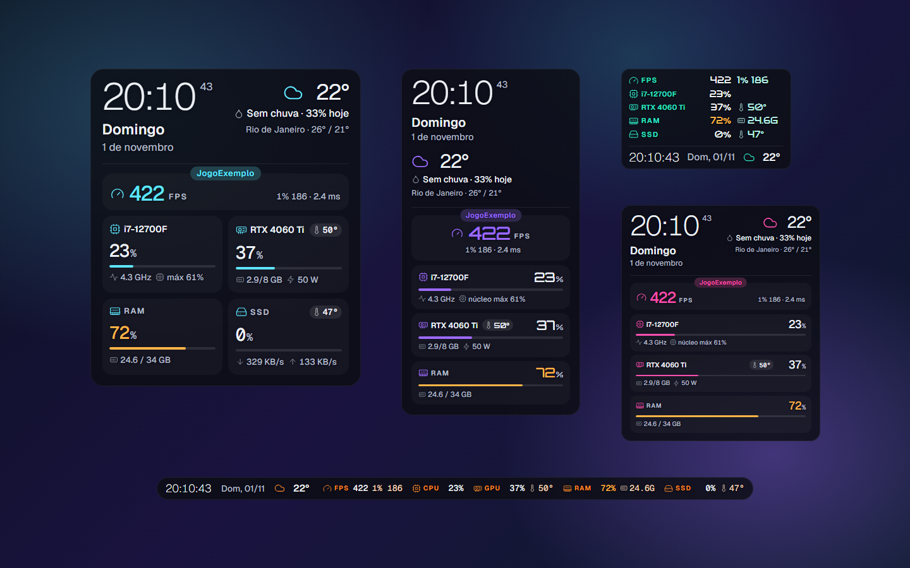
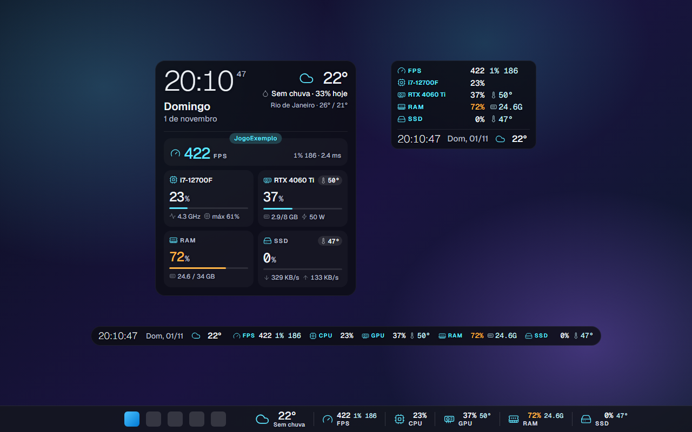
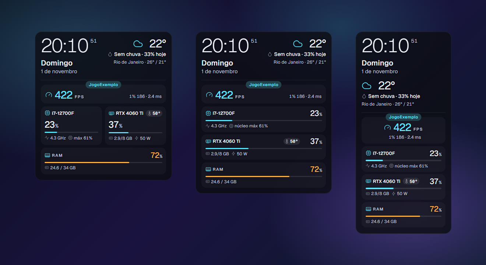
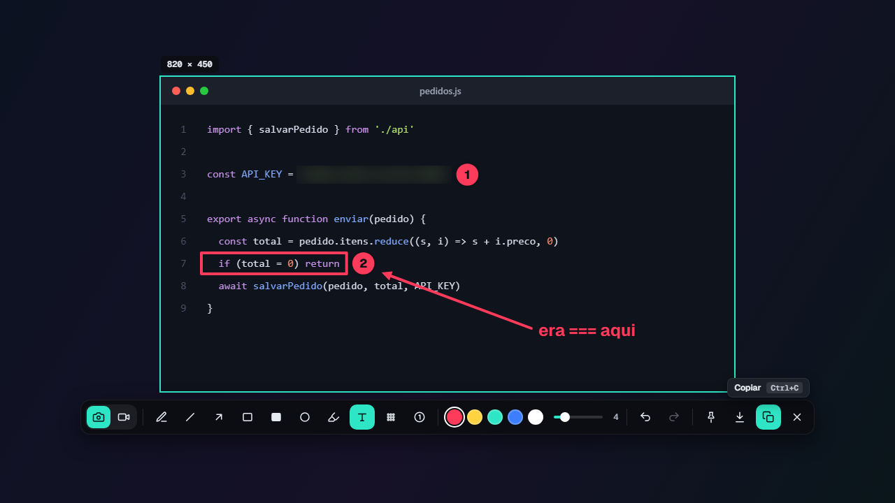
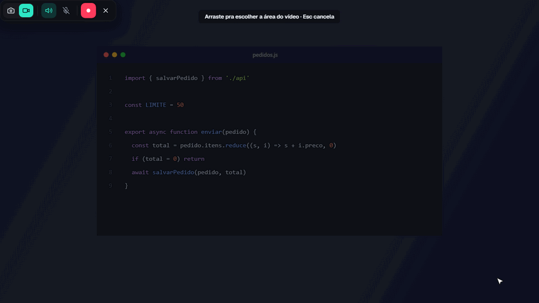
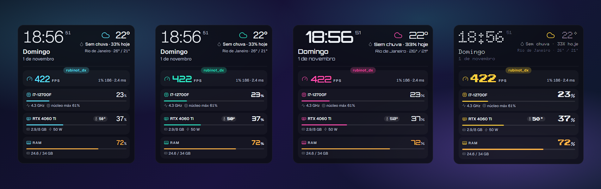
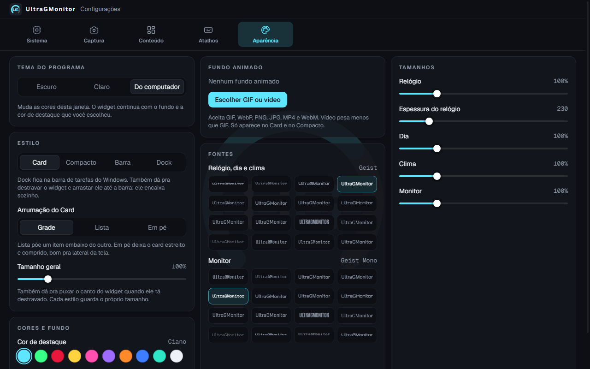
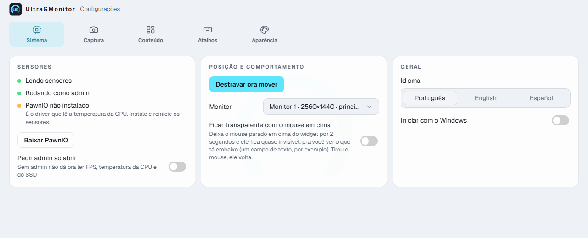
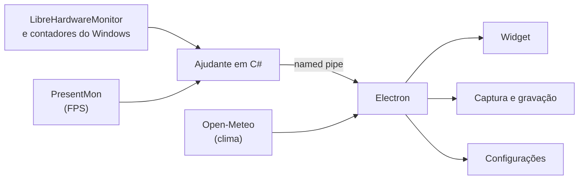

<p align="center"></p>

<h1 align="center">UltraGMonitor</h1>

<p align="center">
  <strong>Monitor de hardware, FPS, relógio, clima, captura de tela e gravação de vídeo num app só, pro Windows.</strong><br />
  Leve, gratuito, de código aberto e feito pra ficar num canto da tela ou por cima do jogo sem atrapalhar.
</p>

<p align="center">
  <a href="../../releases"></a>
</p>

<p align="center">
  
  
  
  
  
  
</p>

<p align="center">
  <a href="#por-que-o-ultragmonitor-existe">Por que existe</a> ·
  <a href="#recursos">Recursos</a> ·
  <a href="#instalação">Instalação</a> ·
  <a href="#atalhos">Atalhos</a> ·
  <a href="#privacidade">Privacidade</a> ·
  <a href="#como-funciona">Como funciona</a> ·
  <a href="#rodando-a-partir-do-código">Código</a>
</p>



## Por que o UltraGMonitor existe

Sou desenvolvedor e jogo no mesmo PC em que trabalho. Com o tempo, percebi que vivia abrindo um programa diferente pra cada coisa: um pra ver o FPS e saber se o jogo estava rodando liso, outro pra conferir o uso e a temperatura da CPU e da GPU, outro pra tirar um print e marcar o que importava, outro pra gravar a tela e mostrar um bug pro time. E eu ainda queria ter relógio, data e clima sempre à vista, sem precisar abrir nada.

Cada uma dessas ferramentas resolvia um pedaço do problema. Juntas, pesavam no sistema, lotavam a bandeja do Windows e nenhuma conversava com a outra.

O UltraGMonitor nasceu pra resolver isso: **um app só, leve e bonito, que reúne as necessidades do dia a dia de quem desenvolve e joga**, e que fica discreto num canto da tela até a hora em que você precisa dele. Entender como o jogo está rodando, acompanhar a saúde do PC, registrar um bug com print anotado ou vídeo: tudo no mesmo lugar, com o mesmo visual e os mesmos atalhos.

Se você também vive entre o código e o jogo, ou só quer entender de verdade como o seu PC está se comportando, ele foi feito pra você. E por ser código aberto, a comunidade pode ajudar a deixá-lo ainda melhor.

— **Paulo Azevedo**, criador do UltraGMonitor

## Destaques

- **FPS do jogo em foco**, com 1% low e frametime, medido sem injetar nada no jogo
- **CPU, GPU, RAM e SSD em tempo real**: uso, temperatura, clock, VRAM, consumo em watts e velocidade do disco
- **Relógio, data e clima** sempre à vista
- **Captura de tela com anotação**: seta, texto, desfoque, numeração e mais, no estilo das melhores ferramentas de print
- **Gravação de vídeo** de uma área da tela, com som do PC e microfone, pronta pra colar no chat
- **4 estilos** (Card, Compacto, Barra e Dock na barra de tarefas) e **3 arrumações** do Card
- **Personalização completa**: 16 fontes, 10 cores, tamanhos, transparência e fundo animado
- **Tema claro, escuro ou do sistema** e o app inteiro em **português, inglês e espanhol**
- **Sem conta, sem anúncio, sem telemetria**

## Recursos

### Monitoramento em tempo real

| | O que mostra |
|---|---|
| **CPU** | Uso, clock real (o mesmo número do Gerenciador de Tarefas), núcleo mais usado, temperatura e consumo em watts* |
| **GPU** | Uso, temperatura, VRAM usada e total, consumo em watts |
| **RAM** | Uso em porcentagem e em GB |
| **SSD / HD** | Atividade, velocidade de leitura e escrita e temperatura. Você escolhe qual disco aparece |

<sub>* Temperatura e watts da CPU precisam do driver PawnIO, que o instalador já instala.</sub>

- **Cores de alerta:** CPU, GPU e SSD usam a temperatura pra sinalizar atenção; uso alto durante um jogo não fica vermelho sozinho. A RAM avisa a partir de 90% e fica vermelha a partir de 97%, quando o uso persiste por 3 segundos. As temperaturas têm limites próprios pra CPU, GPU e SSD.
- **Estado dos sensores:** destrave o widget pra ver se está carregando, sem permissão, com leitura interrompida ou com algum sensor indisponível. Dados antigos deixam de aparecer como se ainda fossem atuais.
- **Nome do hardware do seu jeito:** só "CPU" e "GPU", o nome (i7-12700F, RTX 4060 Ti) ou só o modelo (12700F, 4060 Ti).

### FPS do jogo

- FPS, **1% low** e **frametime** do jogo que está em foco, com o nome do jogo numa etiqueta em cima do quadro.
- Medido pelo [PresentMon](https://github.com/GameTechDev/PresentMon), da Intel, que lê os eventos do próprio Windows. Nada é injetado no jogo e nenhum arquivo dele é tocado.
- Sem jogo rodando, o FPS sai de cena. Quando o jogo abre, ele volta sozinho com uma transição suave.
- O número muda de cor quando a queda persiste por 3 segundos: amarelo em 50 FPS ou menos, vermelho em 30 ou menos.
- Liga e desliga com um atalho, sem abrir nada.

### Relógio, data e clima

- Relógio com ou sem segundos, em 24h ou AM/PM, com dia da semana e data no idioma escolhido.
- Clima da sua cidade: temperatura atual, se está chovendo, chance de chuva no dia e a máxima e a mínima. Os dados vêm do [Open-Meteo](https://open-meteo.com/), sem cadastro e sem chave.

### Quatro estilos



- **Card:** o painel completo, com tudo em destaque.
- **Compacto:** uma lista enxuta, ótima pra deixar por cima do jogo.
- **Barra:** tudo numa linha só, pra encostar na borda da tela.
- **Dock:** encaixado na barra de tarefas do Windows. É só arrastar o widget até ela.

### Três jeitos de arrumar o Card



- **Grade:** dois quadros por linha. Se sobrar um sozinho, ele ocupa a linha inteira.
- **Lista:** um item embaixo do outro, com mais espaço pros detalhes.
- **Em pé:** estreito e comprido, perfeito pra lateral do monitor.

### Captura de tela



- Abre com um atalho (**Print Screen** por padrão). É só arrastar pra escolher a área e ajustar pelas bordas.
- **10 ferramentas:** lápis, linha, seta, retângulo, retângulo cheio, círculo, marcador, texto, desfoque (pra esconder senha, chave e dado pessoal) e numeração de passos.
- 5 cores e espessura ajustável, com desfazer e refazer.
- **Copiar** com `Ctrl+C`, **salvar** com `Ctrl+S` ou **fixar na tela**, como uma janelinha que fica por cima de tudo.
- **Extrair texto:** selecione uma área com texto e abra uma prévia editável antes de copiar. Dá pra copiar tudo ou só o trecho selecionado. O reconhecimento funciona offline em português, inglês e espanhol, sem cadastro ou serviço pago. Letras pequenas, borradas ou com pouco contraste podem sair erradas; o app avisa pra revisar.
- Todo print copiado também vira um arquivo PNG na pasta de prints, pra você achar depois.
- **Últimos prints:** uma janelinha com os prints e vídeos mais recentes. Clique pra copiar de novo, arraste pra soltar direto no chat ou no e-mail, ou use o botão direito pra fixar, abrir, mostrar na pasta ou mandar pra lixeira.
- No Windows, dá pra usar o **`Win+Shift+S`** pra abrir a captura do UltraGMonitor no lugar da Ferramenta de Captura (opcional, na aba Atalhos).
- Por padrão, prints e vídeos vão pra `Imagens\UltraGMonitor`, em `Prints` e `Vídeos`. Dá pra trocar cada pasta na aba Captura.

### Gravação de vídeo



- Escolha a área e grave com o **som do PC** e o **microfone**, ligando e desligando cada um na hora.
- Uma barra flutuante mostra o tempo e deixa pausar, continuar e parar.
- O vídeo vai pra pasta de vídeos em MP4 e **já fica copiado**: é só dar `Ctrl+V` no chat, no e-mail ou na issue.
- Os blocos de vídeo são gravados no disco durante a captura. Se houver uma interrupção, o arquivo `.partial.mp4` ou `.partial.webm` fica preservado e identificado em Últimos prints; a reprodução do arquivo parcial pode estar incompleta. O formato WebM é usado quando o MP4 não está disponível.
- O app avisa se não conseguiu captar o áudio do PC ou o microfone e diferencia vídeo salvo de vídeo copiado.

### Personalização



- **16 fontes** e **10 cores de destaque**.
- **Prévia ao vivo** na aba Aparência, com as leituras atuais do PC. As fontes mostram exemplos de hora, porcentagem e temperatura; use **Ver todas as fontes** para expandir a lista.
- Tamanho de cada parte: relógio, espessura do relógio, data, clima e números.
- **Transparência do fundo**, que dá pra ajustar também direto na barra de edição do widget, sem abrir as configurações.
- **Fundo animado** com GIF, WebP, imagem ou vídeo (no Card e no Compacto).
- Cada estilo guarda o próprio tamanho.
- Você escolhe o que aparece: relógio, data, clima, FPS, CPU, GPU, RAM e SSD.
- Quer só a captura? Desligue o **Monitoramento**: o widget some e o app fica quietinho na bandeja, só com captura e gravação.

### Feito pra ficar por cima do jogo

- Funciona por cima de jogos em janela ou em tela cheia sem borda.
- O clique atravessa o widget, então ele nunca rouba o foco do jogo.
- Opcional: fica quase invisível quando você deixa o mouse parado em cima, pra ver o que está embaixo.
- Arraste pra qualquer canto de qualquer monitor e redimensione puxando o canto.

### Configurações

<table>
  <tr>
    <td></td>
    <td></td>
  </tr>
</table>

- Organizadas em abas: **Sistema, Captura, Conteúdo, Atalhos e Aparência**.
- **Tema** escuro, claro ou o mesmo do Windows.
- **Português, inglês e espanhol.** O idioma muda o app inteiro: widget, captura, bandeja, avisos e até o nome dos arquivos salvos.
- Todos os atalhos são configuráveis, e o app avisa se outro programa já usa a tecla.
- Avisa quando sai versão nova, com um botão pra baixar.

## Instalação

1. Baixe o `UltraGMonitor-Setup.exe` na página [Releases](../../releases).
2. Rode o instalador. Ele instala o app, o driver PawnIO (temperatura da CPU) e configura o UltraGMonitor pra abrir junto com o Windows.
3. Pronto: o widget aparece no canto da tela e o ícone fica na bandeja.

**Requisitos:** Windows 10 ou 11, 64 bits.

### Atualizando

Quando sai uma versão nova, o UltraGMonitor avisa com uma notificação do Windows e um item na bandeja. É só baixar o instalador novo e rodar por cima: não precisa desinstalar, e as suas configurações continuam do jeito que estavam.

> **Aviso do Windows:** o instalador ainda não tem assinatura digital. Se o Windows mostrar "O Windows protegeu o computador", clique em **Mais informações → Executar assim mesmo**. Com o Smart App Control ligado, o Windows bloqueia instaladores sem assinatura. A assinatura digital está nos planos.

### Permissão de administrador

O FPS e as temperaturas da CPU e do SSD precisam de admin. O app só pede quando você liga o FPS ou marca **Pedir admin ao abrir**, na aba Sistema. Sem admin, todo o resto funciona normalmente.

### Linux (beta)

Na página [Releases](../../releases) tem duas opções pra Linux, 64 bits:

- **`.deb`** pra Ubuntu, Linux Mint, Pop!_OS e outros derivados do Debian:
  ```bash
  sudo apt install ./UltraGMonitor-linux-amd64.deb
  ```
- **`.AppImage`** pra qualquer distribuição: dê permissão de execução e abra. No Ubuntu 24.04 ou mais novo, prefira o `.deb`, porque o sistema bloqueia o AppImage de apps Electron.

O que funciona no Linux: CPU (uso, clock, temperatura e consumo quando o sistema libera), GPU NVIDIA (com o driver da NVIDIA instalado) e AMD, RAM, discos, relógio, clima, captura de tela, últimos prints e gravação de vídeo. Nada disso precisa de driver extra.

O que ainda não tem:

- **FPS:** o PresentMon só existe no Windows. Está nos planos.
- **Dock na barra de tarefas** e **`Win+Shift+S`**: são coisas do Windows.
- **Som do PC na gravação:** pode não funcionar em todas as distribuições. O microfone funciona.

Funciona melhor em sessões **X11**, como o padrão do Linux Mint. No **Wayland**, como o padrão do Ubuntu:

- os atalhos do app só funcionam com ele em foco. Crie um atalho do sistema em Configurações → Teclado → Atalhos personalizados com o comando `ultragmonitor --capture`. Também valem `--record` e `--history`;
- se a `Print Screen` já for do sistema, troque o atalho do app ou desligue o do sistema.

No GNOME, o ícone na bandeja precisa da extensão **AppIndicator**, que já vem no Ubuntu.

## Atalhos

Todos podem ser trocados na aba **Atalhos**.

| Atalho padrão | Ação |
|---|---|
| `Print Screen` | Abrir a captura de tela |
| sem atalho | Gravar vídeo (defina o seu, ou use o botão de vídeo na captura) |
| sem atalho | Abrir os últimos prints (defina o seu, ou use a bandeja ou o botão na captura) |
| `Ctrl+Shift+H` | Destravar e travar o widget pra mover, redimensionar e trocar o estilo |
| `Ctrl+Shift+F` | Ligar e desligar o FPS |
| `Ctrl+Shift+O` | Mostrar e esconder o widget |

Dentro da captura:

| Tecla | Ação |
|---|---|
| `Ctrl+C` | Copiar o print |
| `Ctrl+S` | Salvar o print |
| `Ctrl+Z` / `Ctrl+Y` | Desfazer / refazer |
| `Enter` | Começar a gravar (no modo vídeo) |
| `Esc` | Cancelar |

## Privacidade

- Sem conta, sem anúncio e sem telemetria.
- O app só se conecta a dois lugares: o Open-Meteo, pra buscar a cidade e o clima, e o GitHub, uma vez por dia, pra ver se saiu versão nova (dá pra desligar na aba Sistema).
- Prints e vídeos ficam só no seu computador.
- A extração de texto roda no próprio computador, com os arquivos de reconhecimento incluídos no app. Nenhuma imagem ou texto é enviado pra um servidor.
- As configurações ficam num arquivo local, na pasta de dados do app (`%APPDATA%\UltraGMonitor`).

## Como funciona



- **Electron** cuida das janelas, do visual, das configurações, da captura e da gravação.
- Um **ajudante em C#** (`sensor/`) lê os sensores com a LibreHardwareMonitorLib, os contadores de CPU e de disco do Windows, o FPS pelo PresentMon e tira o print da tela. Ele manda tudo pro Electron por um named pipe, uma linha de JSON por leitura.
- O ajudante só roda como admin quando precisa: pra ler o FPS e as temperaturas.
- No **Linux**, não tem ajudante: o próprio app lê o `/proc` e o `/sys` do sistema e, se tiver placa NVIDIA, o `nvidia-smi`.

### Estrutura do projeto

```
src/main/        processo principal: janelas, bandeja, atalhos, captura, gravação, clima e os sensores do Linux
src/preload/     ponte segura entre as telas e o processo principal
src/renderer/    as telas: widget, configurações, captura, gravação, últimos prints e avisos
sensor/          ajudante em C# que lê os sensores, o FPS e tira o print no Windows
scripts/         baixar dependências, compilar o ajudante, gerar ícones e o instalador
resources/       PresentMon, PawnIO e scripts do instalador
assets/          logo e ícones
```

## Rodando a partir do código

Precisa de **Node.js 20+** e do **.NET SDK 8+**.

```bash
npm install
npm run setup
npm start
```

O `npm run setup` baixa o PresentMon e o PawnIO e compila o ajudante em C#.

`npm test` verifica os caminhos de sensores, permissões, RAM, captura, gravação e recuperação das configurações. `npm run test:ui` verifica as telas e grava um vídeo de teste com pausa, retomada e reprodução. No Linux sem ambiente gráfico, use `xvfb-run -a npm run test:ui`.

No Linux, basta o Node.js: rode `npm install` e `npm start`. Lá os sensores são lidos direto pelo app, sem o ajudante em C#.

Pra gerar o instalador:

```bash
npm run dist
```

No Windows sai o instalador `.exe`; no Linux, o `.AppImage` e o `.deb`. Tudo vai pra `dist/`. Pra regenerar os ícones depois de mexer em `assets/logo.svg` ou `assets/logo-mark.svg`, rode `npm run icons`.

### Publicando uma versão

As mudanças de cada versão ficam no [changelog](CHANGELOG.md). Atualize a versão do app e essa lista antes de criar a tag.

Ao criar uma tag `v*` (por exemplo, `v0.5.0`), o GitHub Actions testa e gera os instaladores do Windows e do Linux. A publicação só acontece quando os dois terminam, usando as notas da versão no changelog.

## Contribuindo

Contribuições são muito bem-vindas.

- **Encontrou um bug ou tem uma ideia?** Abra uma [issue](../../issues) contando a versão do Windows, o modelo da CPU e da GPU e o que aconteceu.
- **Quer traduzir pra outro idioma?** Os textos ficam em `src/renderer/shared/i18n.js`. Cada idioma é um dicionário que parte do texto em português.
- **Quer mexer no código?** Faça um fork, crie um branch e abra um pull request explicando o que mudou e por quê.

## Licença

Código sob a [GNU GPL v3.0](LICENSE). Você pode usar, estudar, modificar e redistribuir, desde que versões modificadas continuem abertas sob a mesma licença e mantenham o crédito ao autor original.

Copyright (C) 2026 Paulo Azevedo

## Nome e logo

O nome **UltraGMonitor** e o logo são de Paulo Azevedo e **não** estão cobertos pela GPL. Cópias e versões modificadas precisam usar outro nome e outro logo, e não podem se apresentar como o UltraGMonitor oficial.

## Créditos

- [LibreHardwareMonitor](https://github.com/LibreHardwareMonitor/LibreHardwareMonitor) (MPL-2.0): leitura dos sensores
- [PresentMon](https://github.com/GameTechDev/PresentMon) (MIT), da Intel: medição de FPS
- [PawnIO](https://pawnio.eu/): driver de acesso ao hardware
- [Open-Meteo](https://open-meteo.com/): dados do clima
- [Electron](https://www.electronjs.org/): base do app
- [Tesseract.js](https://github.com/naptha/tesseract.js) (Apache-2.0): reconhecimento de texto offline
- Fontes do [Google Fonts](https://fonts.google.com/) via [Fontsource](https://fontsource.org/)

---

<p align="center">Feito por <a href="https://github.com/bypauloazevedo">Paulo Azevedo</a>, pra quem vive entre o código e o jogo.</p>
